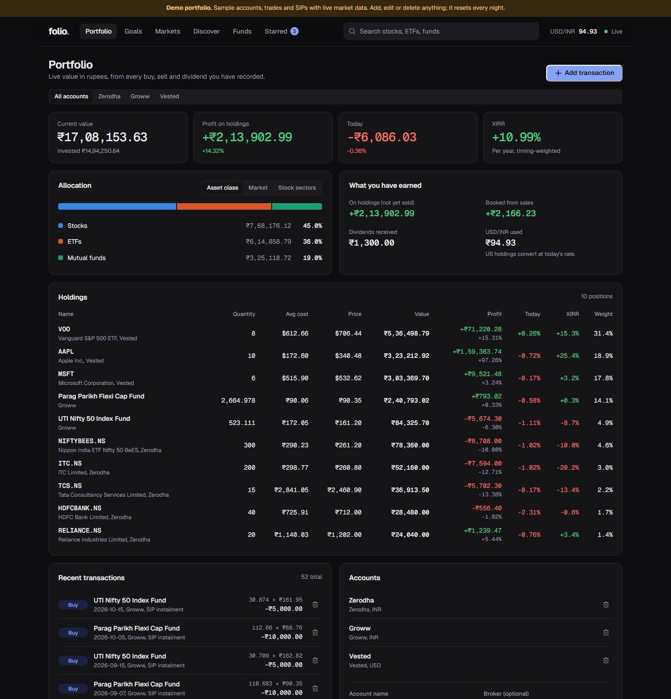
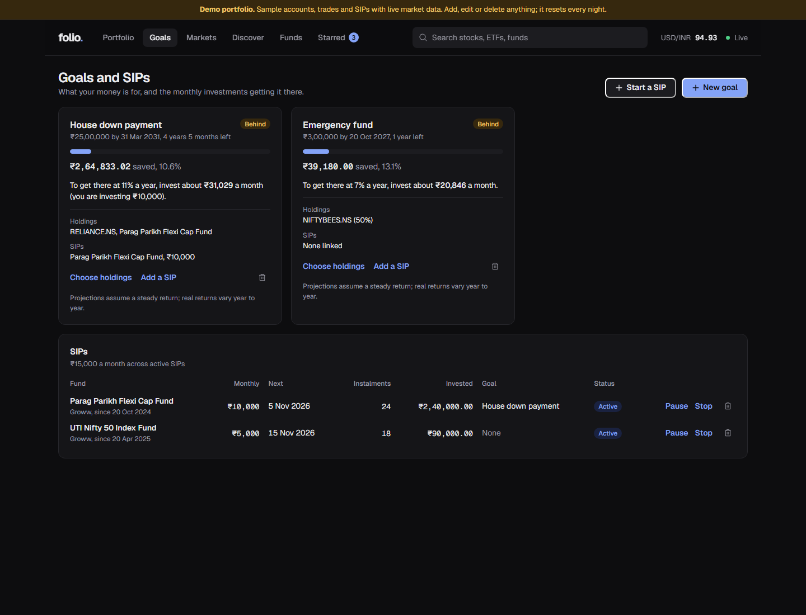
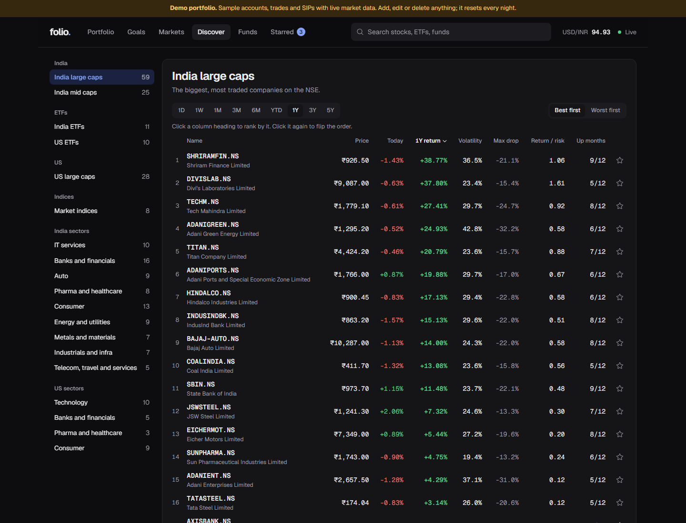
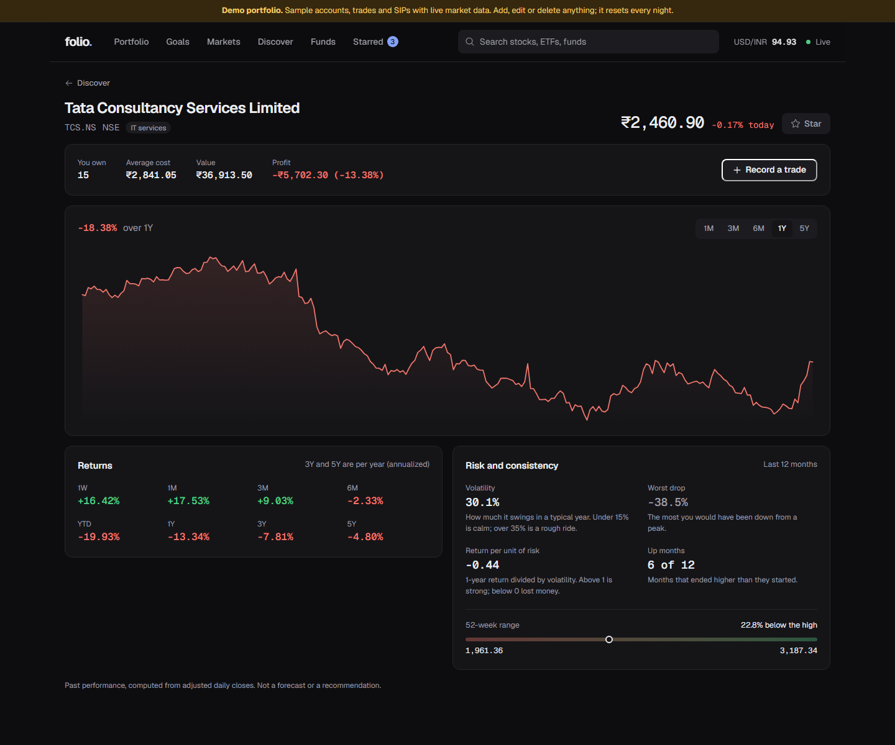
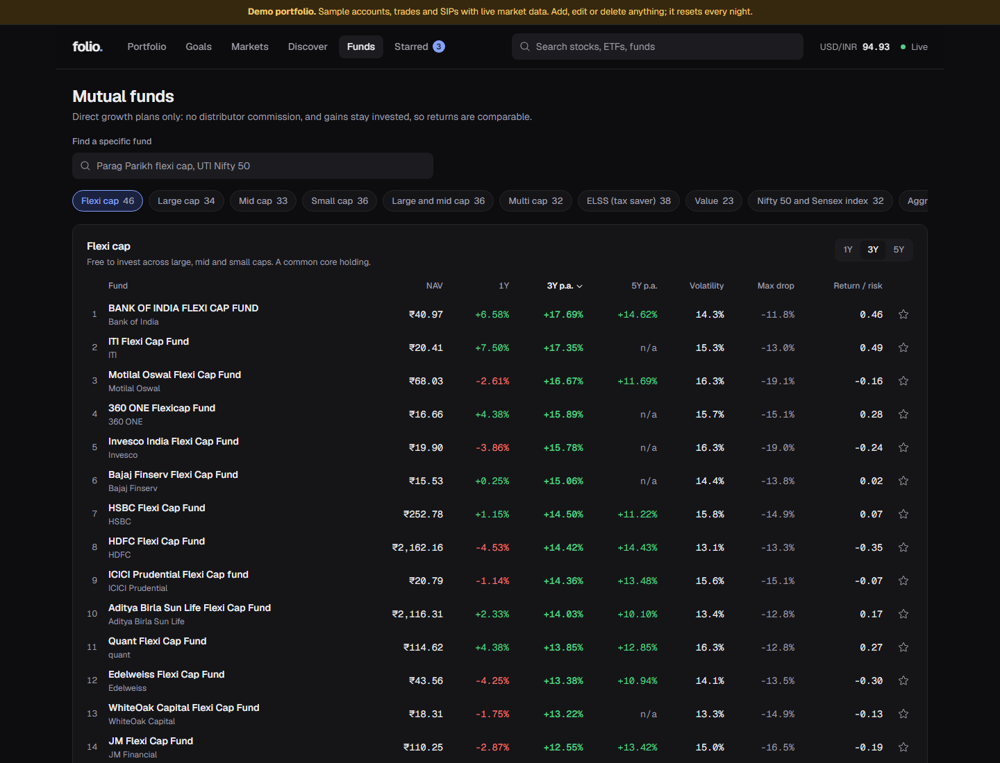
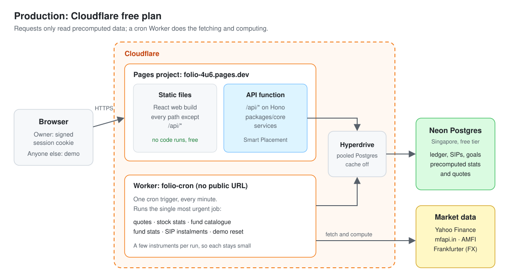
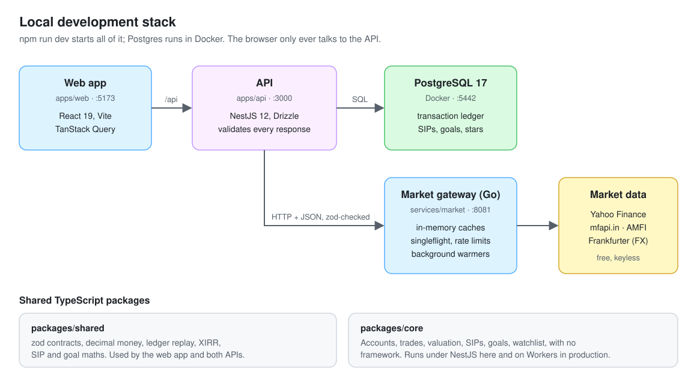
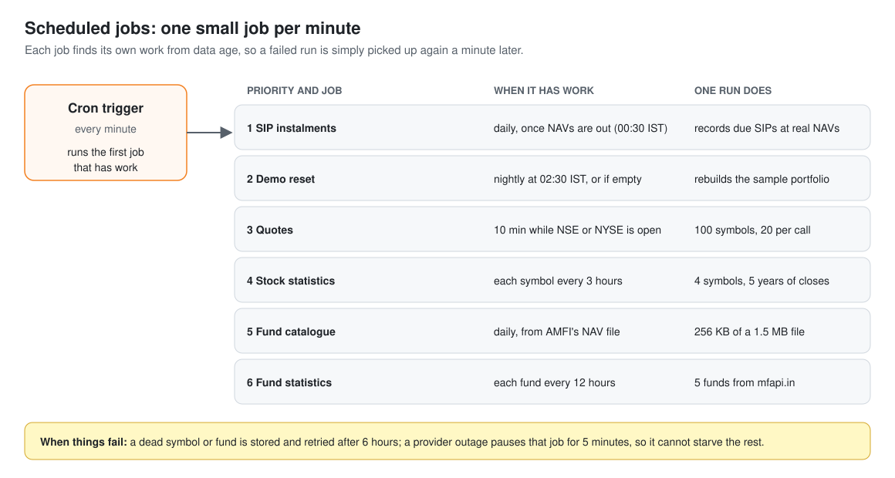

# Folio

[](https://github.com/abhishek-pandey7/Folio-Wealth-Tracker/actions/workflows/ci.yml)

A personal wealth tracker for investors who hold Indian and US assets across several brokers.

Folio values NSE and US stocks, ETFs and Indian mutual funds live, converts between INR and USD, and is built around a transaction ledger: holdings, cost basis, realized gains and XIRR are always derived from history, never edited by hand. SIPs record their own instalments at each date's real NAV, goals track what your money is for, and screeners rank stocks and funds by return, risk and consistency.

**Live demo: [folio-4u6.pages.dev](https://folio-4u6.pages.dev)**. It opens a sample portfolio with live market data. Add, edit or delete anything; it resets every night.



## What it does

| | |
| --- | --- |
|  |  |
| **Goals and SIPs.** Each goal shows progress from linked holdings and SIPs, and the monthly amount needed at an assumed return. SIPs started in the past are backfilled at each instalment date's real NAV. | **Discover.** 141 curated stocks, ETFs and indices in 19 lists (India and US, by size and sector), ranked by return over any period, volatility, worst drop, return per unit of risk, or up months. |
|  |  |
| **Stock pages.** Price history, returns from one week to five years (3y and 5y annualized), risk statistics with plain-language explanations, and your own position. | **Mutual funds.** About 380 Direct Growth schemes in 11 SEBI categories from AMFI's official NAV file, ranked the same way. |

Also: several broker accounts in INR and USD, buys, sells and dividends checked against the ledger (no overselling), FIFO lots, starred stocks and funds, and allocation by asset class, market and sector.

## How it is built

The app runs in two shapes that share all business logic (`packages/core`).

**Production, on Cloudflare's free plan.** Pages serves the web build and the API; a cron Worker fetches market data and precomputes statistics into Postgres, so a request only reads.



**Local development.** A NestJS API, a Go market data gateway with in-memory caches, and Postgres in Docker.



Workers get 10 ms of CPU per invocation and keep no memory between requests, so the Go gateway's caches and background warmers became Postgres tables and one cron trigger that runs a single small job each minute:



Every decision, the alternatives that were rejected, and measured numbers are in [`docs/ARCHITECTURE.md`](docs/ARCHITECTURE.md). Deploying it yourself: [`docs/DEPLOY.md`](docs/DEPLOY.md). Performance and quality measurements: [`docs/KPIS.md`](docs/KPIS.md).

## Highlights

- **Decimal-safe money** end to end: `NUMERIC` in Postgres, decimal strings on the wire, `decimal.js` and `shopspring/decimal` in code.
- **Ledger-first data model.** Every sale is replayed against the account's history inside a row lock, so concurrent requests cannot oversell.
- **Statistics that compare fairly:** dividend-adjusted closes, annualized multi-year returns, and no 1-year risk numbers for anything with less than a year of history. On side-by-side runs, the TypeScript port matched the Go gateway exactly for Indian and US large caps and flexi-cap funds.
- **Go market gateway** with per-type caching, request coalescing (singleflight), stale-while-revalidate, per-upstream rate limiting and background warming: 713 ranked screens a second locally.
- **One codebase, two runtimes:** framework-free services in `packages/core`, wired into NestJS locally and Hono on Cloudflare.
- **Shared zod contracts** validate every response at each boundary.
- **Tested against real Postgres:** 137 TypeScript tests plus the Go suite (89% coverage), run on every PR alongside Biome, type-checking, `go test -race` and production builds.

## Stack

| Layer | Tech |
| --- | --- |
| Web | React 19, Vite, TanStack Query, React Router, Geist |
| API | NestJS 12 locally, Hono on Cloudflare; Drizzle ORM, zod |
| Market data | Go 1.27 gateway locally; TypeScript port on a Cloudflare cron Worker |
| Database | PostgreSQL 17 (Docker locally, Neon via Hyperdrive in production) |
| Hosting | Cloudflare Pages and Workers, free plan |
| Tooling | npm workspaces, Biome, Vitest, Go `testing/synctest`, Docker, GitHub Actions, Wrangler |

## Getting started

Requires Node 22+, Go 1.27+ and Docker.

```bash
npm install                # also builds packages/shared and packages/core
cp .env.example .env
npm run db:up              # Postgres in Docker on localhost:5442
npm run db:migrate
npm run dev                # API, Go gateway and web app in watch mode
```

Open http://localhost:5173.

| Port | Service |
| --- | --- |
| 5173 | Web app (proxies `/api` to the API) |
| 3000 | NestJS API |
| 8081 | Go market gateway (internal, loopback only) |
| 5442 | PostgreSQL |

Set `MARKET_DATA_MODE=mock` to run fully offline with deterministic fake data. To run the Cloudflare version locally instead, see [`docs/DEPLOY.md`](docs/DEPLOY.md#local-development-against-the-workers-runtime).

## Scripts

| Command | What it does |
| --- | --- |
| `npm run dev` | Everything in watch mode |
| `npm test` | TypeScript tests (integration tests need `DATABASE_URL`) |
| `npm run test:market` | Go tests |
| `npm run typecheck` | Type-check all TypeScript workspaces |
| `npm run lint` | Biome lint and format check |
| `npm run db:generate` | Create a migration from schema changes |
| `npm run stack:up` | Postgres and the gateway in Docker |
| `npm run bench` | Load test the running stack (see docs/KPIS.md) |
| `npm run deploy -w @folio/worker` | Build and deploy to Cloudflare (Pages and the cron Worker) |

## Layout

```
apps/web           React dashboard
apps/api           NestJS API (owns Postgres, proxies market data)
apps/worker        The same app on Cloudflare: Pages API, cron Worker, market data engine
services/market    Go market data gateway
packages/core      Business logic, free of any framework
packages/shared    API contracts and decimal-safe domain math
docs/              Architecture, deployment and measured KPIs
```
