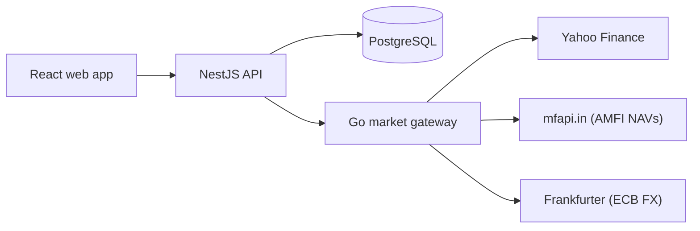

# Folio

A personal portfolio manager for investors who hold Indian and US assets across several brokers.

Folio values NSE, BSE and US stocks, ETFs and Indian mutual funds live, converts between INR and USD, and is built around a transaction ledger so holdings, cost basis and returns are always derived from history rather than edited by hand.

**How it's built and why:** [`docs/ARCHITECTURE.md`](docs/ARCHITECTURE.md) covers every major decision, the alternatives that were rejected, caching and failure handling, the scaling path, and the roadmap.

**Measured performance and quality:** [`docs/KPIS.md`](docs/KPIS.md). Rankings serve 713 req/s at p99 224 ms; 99.99% of cache lookups are answered from memory; 89% Go test coverage; 95 TypeScript tests including 26 against real Postgres.



## Highlights

- **Go market data gateway** with per-type caching, request coalescing (singleflight), stale-if-error, per-upstream rate limiting and bounded concurrent batch fetching.
- **Decimal-safe money** end to end: `NUMERIC` in Postgres, decimal strings on the wire, `decimal.js` and `shopspring/decimal` in code.
- **Shared zod contracts** validate every response at each service boundary.
- **Ledger-first data model** for auditable holdings.
- **Request tracing** across services with propagated request IDs.
- **CI on every PR:** Biome, type-checking, unit tests, `go test -race`, production builds and a Docker image build.

## Stack

| Layer | Tech |
| --- | --- |
| Web | React 19, Vite, TanStack Query, Geist |
| API | NestJS 12 (ESM), Drizzle ORM, zod |
| Market gateway | Go 1.27, standard library HTTP, `x/sync`, `x/time/rate` |
| Database | PostgreSQL 17 |
| Tooling | npm workspaces, Biome, Vitest, Go `testing/synctest`, Docker, GitHub Actions |

## Getting started

Requires Node 22+, Go 1.27+ and Docker.

```bash
npm install                # also builds packages/shared and packages/core
cp .env.example .env
npm run db:up              # Postgres in Docker on localhost:5442
npm run db:migrate
npm run dev                # API, Go gateway and web app in watch mode
```

Open http://localhost:5173.

| Port | Service |
| --- | --- |
| 5173 | Web app (proxies `/api` to the API) |
| 3000 | NestJS API |
| 8081 | Go market gateway (internal, loopback only) |
| 5442 | PostgreSQL |

Set `MARKET_DATA_MODE=mock` to run fully offline with deterministic fake data.

## Scripts

| Command | What it does |
| --- | --- |
| `npm run dev` | Everything in watch mode |
| `npm test` | TypeScript unit tests |
| `npm run test:market` | Go tests |
| `npm run typecheck` | Type-check all TypeScript workspaces |
| `npm run lint` | Biome lint and format check |
| `npm run db:generate` | Create a migration from schema changes |
| `npm run stack:up` | Postgres and the gateway in Docker |
| `npm run bench` | Load test the running stack (see docs/KPIS.md) |

## Layout

```
apps/web           React dashboard
apps/api           NestJS API (owns Postgres, proxies market data)
apps/worker        The same app on Cloudflare Workers (see docs/DEPLOY.md)
services/market    Go market data gateway
packages/core      Business logic, free of NestJS so Workers can run it too
packages/shared    API contracts and decimal-safe domain math
docs/              Architecture and design decisions
```
