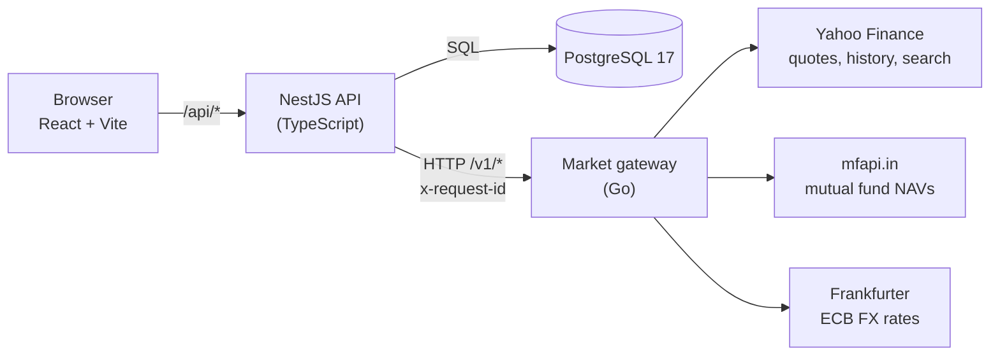
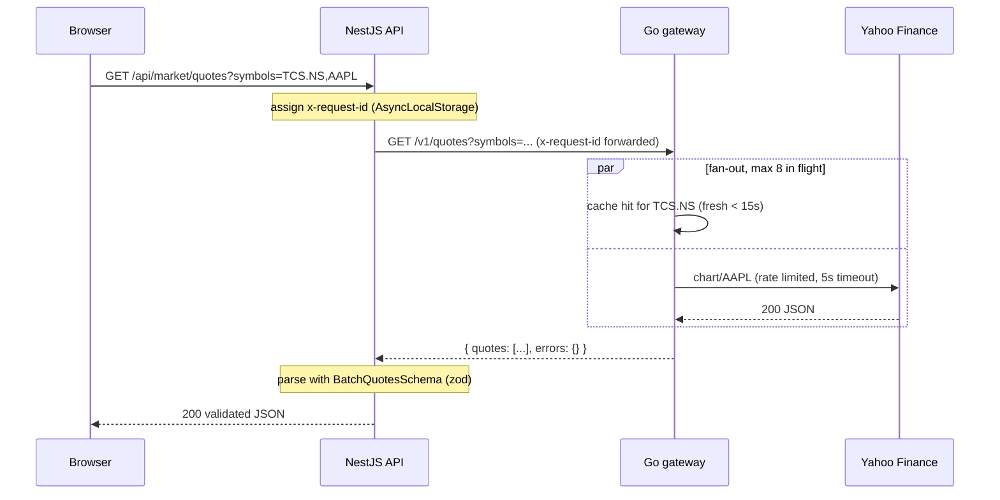
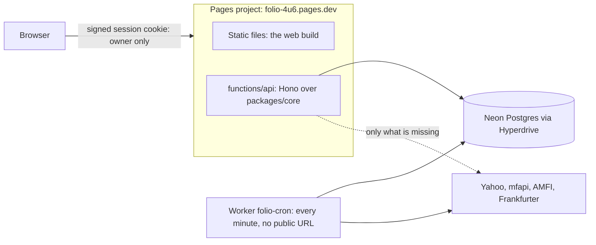
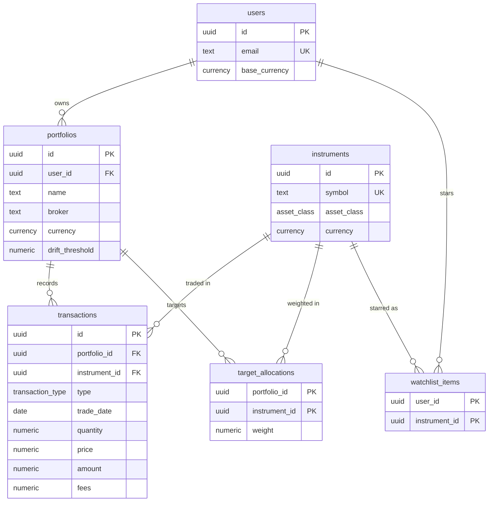

# Folio architecture

Folio is a personal portfolio manager for an investor who holds Indian and US assets across several brokers. This document explains how it is built, why each major choice was made, what was rejected, and where the design goes next.

It is written to be read top to bottom once, then used as a reference.

- [1. Goals and constraints](#1-goals-and-constraints)
- [2. System overview](#2-system-overview)
- [3. Decisions (why this, why not that)](#3-decisions-why-this-why-not-that)
- [4. System design](#4-system-design)
- [5. Data model](#5-data-model)
- [6. Built today vs. planned](#6-built-today-vs-planned)
- [7. Interview talking points](#7-interview-talking-points)

---

## 1. Goals and constraints

**Goals**

1. Track every holding (Indian stocks and ETFs, US stocks, Indian mutual funds) in one place, valued live.
2. Get the numbers right. Money is never a float; holdings are derived from an auditable ledger.
3. Keep working when free data sources are slow, rate-limited or down.
4. Be cheap to run: a laptop, or one small VM, with no paid APIs.

**Constraints that shaped the design**

| Constraint | Consequence |
| --- | --- |
| No free official API covers NSE, BSE **and** US equities | Use Yahoo Finance's unofficial endpoints behind an abstraction so they can be swapped |
| Free APIs rate-limit and fail without warning | Cache everything, rate-limit our own outbound calls, serve stale data on failure |
| Mutual funds are priced once a day, stocks every second | Different cache lifetimes per data type |
| INR and USD assets in one portfolio | Currency is a first-class column everywhere; FX rates are a data source |
| Single developer | Prefer boring, well-documented tools; keep the service count small |

---

## 2. System overview

| Component | Responsibility | Owns |
| --- | --- | --- |
| `apps/web` | UI. Never talks to anything except the API. | Nothing persistent |
| `apps/api` | Public API: routing, request validation, validation of every gateway response. A thin NestJS layer over `packages/core`. | PostgreSQL |
| `services/market` | The only component that talks to third-party market data. Caching, rate limiting, failover to stale data. | In-memory caches |
| `packages/core` | Framework-free business logic: accounts, transactions, valuation, SIPs, goals, watchlist. Takes a Drizzle database and a `MarketData` port and throws plain `AppError`s, so the same code runs under NestJS and on Cloudflare Workers. | Nothing (uses the API's database) |
| `packages/shared` | API contracts (zod) and domain math (`Decimal`) used by both the API and the web app | Nothing at runtime |

### A request, end to end

---

## 3. Decisions (why this, why not that)

Each decision lists the alternatives that were seriously considered and why they lost. "It depends" is the honest answer to most of these; the point is to show what it depends *on* here.

### 3.1 Monorepo with npm workspaces

**Chosen:** one repository, npm workspaces (`apps/*`, `packages/*`), Go service alongside.

| Alternative | Why not (here) |
| --- | --- |
| Separate repos per service | Contracts live in `packages/shared` and change together with the API and UI. Separate repos would mean publishing a package for every contract change. |
| Nx / Turborepo | Real value at 10+ packages (task graph caching, affected builds). With three TS packages, `npm run --workspaces` is enough and has nothing to learn. Revisit if CI gets slow. |
| pnpm workspaces | Better disk usage and stricter dependency isolation, but npm ships with Node and removes one setup step for anyone cloning the repo. |

### 3.2 NestJS for the API

**Chosen:** NestJS 12 (native ESM) on Express.

| Alternative | Why not (here) |
| --- | --- |
| Express / Fastify directly | Fine for small APIs, but every structural decision (DI, modules, validation, testing seams) becomes a custom convention. Nest provides them, and they map directly onto enterprise Java/Spring patterns (modules, providers, constructor injection). |
| Hono | Excellent for edge runtimes and very fast, but a thinner ecosystem for the DI and module structure this domain will need (auth, scheduled jobs, queues). |
| Spring Boot / .NET | Strong choices for this domain. Rejected to keep one language across API, UI and shared contracts, so a contract change is type-checked end to end in one `tsc` run. |

Raw framework throughput is irrelevant here: every request waits on Postgres or an upstream API.

### 3.3 Go for the market data gateway

**Chosen:** a separate Go service that owns every third-party market data integration.

The honest reason is **not** raw speed. Nothing at this scale is CPU-bound. The reasons are:

1. **The workload is concurrent I/O.** Valuing a portfolio means fanning out to dozens of symbols with per-upstream rate limits and timeouts. Goroutines, `errgroup` with a concurrency limit, `singleflight` and `x/time/rate` express this directly and are battle-tested.
2. **It is a natural service boundary.** Market data has a different change rate, failure profile and scaling need from portfolio data. Isolating it means a misbehaving upstream (slow responses, malformed JSON) can never exhaust the API's event loop or database pool.
3. **Operational footprint.** A static 17.7 MB distroless image; about 111 MB of memory with every analytics cache warm (141 symbols, 380 funds), measured locally; near-instant startup. See [KPIS.md](KPIS.md).

| Alternative | Why not (here) |
| --- | --- |
| Keep it inside NestJS | Simpler (one fewer service, no network hop). This was the first version. It was moved out to get a hard isolation boundary and independent scaling; the cost is one more deployable and one extra internal HTTP hop per market data request. |
| Rust | Comparable performance, but slower to iterate on and a smaller pool of people who could maintain it. Go's standard library covers everything this service needs. |
| gRPC between API and gateway | Better typing and streaming, but adds codegen and tooling on both sides. Plain HTTP+JSON with zod validation on the consumer side gives most of the safety at a fraction of the complexity. Revisit if the gateway starts streaming prices. |

### 3.4 Backend-for-frontend: the browser never calls the gateway

The API proxies market data instead of exposing the gateway publicly.

- Authentication, rate limiting and CORS live in **one** public service.
- The gateway can stay bound to `127.0.0.1` / the private network with no auth of its own.
- Upstream error details (which provider failed and why) stay in server logs; the browser sees a generic 502.
- The API validates gateway responses against the shared contract, so the UI only ever receives data of the declared shape.

### 3.5 PostgreSQL + Drizzle

**Chosen:** PostgreSQL 17, Drizzle ORM, SQL migrations generated by `drizzle-kit`.

| Alternative | Why not (here) |
| --- | --- |
| MongoDB | The data is relational (users → portfolios → transactions → instruments) and correctness-critical. Foreign keys, `NUMERIC`, transactions and constraints are exactly what a ledger needs. |
| Prisma | Excellent DX, but the query engine is a heavier runtime dependency and the schema lives in its own DSL. Drizzle's schema is TypeScript, its queries read like SQL, and it returns `NUMERIC` as strings (no silent float conversion). |
| TypeORM | Decorator-heavy entities and a long history of subtle migration issues. |
| Raw SQL only | Possible, but loses type-safe queries. Drizzle is close enough to SQL that nothing is hidden. |

### 3.6 Money is never a float

Every price, amount, quantity and weight is:

- `NUMERIC` in Postgres (returned as a string by `pg`),
- a decimal **string** on the wire (enforced by `DecimalStringSchema`; a JSON number fails validation),
- computed with `decimal.js` in TypeScript and `shopspring/decimal` in Go.

`0.1 + 0.2 === 0.30000000000000004` in JavaScript. In a ledger that accumulates thousands of transactions, float error turns into "your holdings are worth ₹0.01 more than the sum of their parts". There is a test (`drift.test.ts`) that demonstrates the float failure next to the decimal result.

The one deliberate exception: the price chart converts closes to `Number` to compute **pixel positions**. Those values never feed back into any calculation.

### 3.7 Ledger as the source of truth

**Chosen:** an append-mostly `transactions` table (buy, sell, dividend, split, deposit, withdrawal, fee). Holdings, cost basis, tax lots and returns are **derived** by replaying it.

| Alternative | Why not |
| --- | --- |
| Mutable `holdings` table (quantity, avg price) | Simple to read, but every correction is a destructive update. After a few edits you cannot explain how a number was reached, and splits or back-dated trades are painful. |
| Full event sourcing (event store, projections, snapshots) | The right pattern at scale, but heavy for one user. The ledger gives the key property (state is a pure function of history) without the infrastructure. |

Derived values can be cached later (a materialized `positions` view refreshed on write) without changing the source of truth.

### 3.8 Shared zod contracts instead of OpenAPI codegen

`packages/shared` defines every API payload once as a zod schema. The API uses it to validate what the gateway returns; the web app uses it to validate what the API returns; TypeScript types are inferred from the same schema.

| Alternative | Why not (here) |
| --- | --- |
| OpenAPI + codegen | The right choice when external clients consume the API. Here both consumers are in the same repo, so a shared package gives the same guarantees with no generation step. The Go side is the one place types are duplicated; a contract test pins it to a captured real response. |
| tRPC | Elegant for TS-to-TS, but couples the client to the server's procedure layout and does not help with the Go service. |

### 3.9 Yahoo Finance, mfapi.in, Frankfurter

| Data | Source | Why | Risk and mitigation |
| --- | --- | --- | --- |
| Stock/ETF quotes, history, search | Yahoo Finance (unofficial `v8/chart`, `v1/search`) | Only free source covering NSE, BSE and US with one symbol format (`RELIANCE.NS`, `500325.BO`, `AAPL`) | Undocumented, can change or rate-limit. Isolated in one Go file behind a `QuoteSource` interface; responses are validated; stale-if-error covers outages. Finnhub/Alpha Vantage are US-centric on free tiers; NSE's own site blocks programmatic access. |
| Mutual fund NAVs | mfapi.in | Free mirror of AMFI's official daily NAV file; search by scheme name | Community-run. AMFI's raw `NAVAll.txt` is the fallback source if it disappears. |
| FX (USD/INR) | Frankfurter (ECB reference rates) | Free, keyless, stable, official underlying data | Daily granularity only, which is fine for valuation. |

Every source has a **mock** implementation (`MARKET_DATA_MODE=mock`) so the whole stack runs offline and in CI.

### 3.10 Tooling

| Choice | Over | Because |
| --- | --- | --- |
| Biome | ESLint + Prettier | One fast binary, one config, lint and format together. |
| Vitest (TS) | Jest | NestJS 12 is ESM-only and Jest's ESM support is still experimental. A Nest DI test proves decorator metadata survives Vitest's transform. |
| `tsc --watch` + `node --watch` | Nest CLI | The Nest CLI compiles through the TypeScript JS API, which TypeScript 7 (native Go port) no longer exposes. Two standard tools replace it. |
| `testing/synctest` (Go) | sleeps, fake clocks | Virtual time makes TTL and concurrency tests instant and deterministic. |
| Docker Compose | k8s locally | Postgres + gateway in one command; Kubernetes is a deployment concern, not a dev one. |

---

## 4. System design

### 4.1 Caching strategy

All caching happens in the gateway, in a generic read-through cache (`internal/cache`).

| Data | Fresh for (TTL) | Served stale for up to | Why |
| --- | --- | --- | --- |
| Quotes | 15 s (configurable) | 24 h | Changes every tick; 15 s keeps the UI live without hammering Yahoo |
| Price history | 1 h | 24 h | Daily bars only change once a day |
| Symbol search | 24 h | none | Listings rarely change; a failed search should say so |
| Mutual fund NAV | 1 h | 72 h | Published once a day after market close |
| FX rate | 1 h | 72 h | ECB publishes once a day |

Four behaviours make this more than a map with timestamps:

1. **Request coalescing (singleflight).** Ten concurrent requests for an uncached `TCS.NS` produce one upstream call; the other nine wait for it. This matters most on cold start and right after TTL expiry, when every client misses at once (the thundering-herd problem).
2. **Stale-if-error.** If the upstream call fails and an expired entry is still inside its stale window, that entry is returned with `"stale": true` instead of an error. The UI labels it "delayed". Users see a slightly old price instead of a broken page.
3. **Stale-while-revalidate for bulk reads.** Rankings overlay live prices on dozens of symbols at once. When those prices expire together, refreshing them through a 5 req/s upstream limit took about 12 s and stalled every request (found by load testing: 7 req/s, p90 9.9 s). Bulk callers now use `Cache.GetFast`, which serves an expired entry at once and refreshes it in one shared background load; the warm job also pre-loads prices. Result: 713 req/s, p99 224 ms. Single-quote lookups still wait for a fresh price.
4. **Detached loads.** The upstream call runs on a context detached from the first caller's, so one user closing their tab cannot cancel a fetch that other users are waiting on. Upstream clients carry their own timeouts, so nothing leaks.

Memory is bounded (`MaxEntries` per cache, oldest-first eviction), so a client sending random symbols cannot grow the cache without limit.

### 4.2 Protecting upstreams (and ourselves)

- **Client-side rate limiting** per upstream with a token bucket (`x/time/rate`): Yahoo 5 req/s burst 10, mfapi 5 req/s, Frankfurter 2 req/s. A burst of cache misses queues instead of getting the IP blocked.
- **Timeouts everywhere:** per-upstream HTTP client timeouts (5 to 8 s), gateway server read/write timeouts, API-to-gateway timeout (8 s), health probe timeout (1.5 s).
- **Bounded fan-out:** batch quotes run at most 8 upstream calls in flight per request, and a batch is capped at 50 symbols.
- **Body size limit:** upstream responses are read through a 5 MB `LimitReader`.

### 4.3 Failure modes

| Failure | What the user sees | Mechanism |
| --- | --- | --- |
| Yahoo down or rate-limiting, symbol was cached recently | Price with a "delayed" tag | stale-if-error |
| Yahoo down, never cached | "Market data is temporarily unavailable" for that symbol; the rest of the watchlist still prices | per-symbol errors in batch responses |
| One bad ticker in a batch | That row shows "unavailable" | batch never fails as a whole |
| Gateway process down | Market panels show an error; API health turns `degraded`; non-market features still work | API maps connection errors to 503; health checks both dependencies |
| Postgres down | Health shows `degraded`; market data still works | pool errors don't crash the process; health uses a 2 s connection timeout |
| Gateway returns malformed data | 502 from the API, contract mismatch logged | zod validation at the API boundary |
| Gateway panics on a request | That request gets a 500 with no internals leaked; process keeps serving | recover middleware |

### 4.4 Observability

- **Request IDs** are assigned by the API (or taken from the caller), stored in `AsyncLocalStorage`, forwarded to the gateway as `x-request-id`, logged on both sides and returned in error bodies. One user action can be traced across both services' logs.
- **Structured logs:** the gateway emits JSON access logs (`slog`) with method, path, status, duration and request ID.
- **Health:** `GET /api/health` reports database and gateway status; `GET /healthz` on the gateway reports per-cache size, hits, misses, stale serves and load errors.
- **Next:** Prometheus metrics (cache hit ratio, upstream latency histograms per provider) and OpenTelemetry traces instead of hand-propagated IDs.

### 4.5 Security

**Today**

- Gateway bound to loopback by default; it is internal and only the API reaches it.
- Containers run as non-root on a distroless base (no shell, no package manager).
- Postgres is published on `127.0.0.1` only.
- Input validation at the edge: symbols, ranges, scheme codes and currency codes are validated with strict patterns before reaching any upstream URL; path segments are escaped.
- No secrets in the repo; `.env` is gitignored and configuration is validated at boot (the API refuses to start with invalid config).
- Upstream error details are never sent to the browser.

**Planned** (needed before more than one person uses it)

- Authentication via OIDC (e.g. Google sign-in) with short-lived JWTs; every query scoped by `user_id` from the token, never from the request body.
- Per-user rate limiting at the API.
- Helmet-style security headers and a strict CSP for the web app.
- Encrypting broker import files at rest once statement uploads exist.

### 4.6 Scaling path

The current design runs comfortably on one machine. If it had to serve many users, it would change in this order (each step only when measurements say so):

1. **Run several API and gateway instances behind a load balancer.** The API is already stateless. The gateway's cache is per-instance, which still works (each instance just has its own hit rate).
2. **Move the gateway cache to Redis** once per-instance caches waste too many upstream calls. Singleflight then needs a distributed lock (or accept some duplicate fetches).
3. **Push instead of poll.** Today the browser polls every 15 s. A background job in the gateway could refresh the most-watched symbols and publish changes (Redis pub/sub or NATS) to a WebSocket/SSE endpoint on the API.
4. **Precompute portfolio valuations.** Materialize positions from the ledger on write; snapshot daily valuations for fast performance charts.
5. **Read replicas** for Postgres if reporting queries start competing with writes.
6. **A paid market data feed** replaces Yahoo behind the same `QuoteSource` interface; nothing else changes.

### 4.7 Analytics and screening

The gateway ranks stocks, ETFs and mutual funds so the app can answer "what has done best over this period?" and "what has done well *steadily*?".

**Metrics** (`internal/analytics`, computed per symbol or scheme):

| Metric | Definition | Why it is there |
| --- | --- | --- |
| Return 1d to 1y | % change from the close at or before the period start | Raw performance |
| Return 3y, 5y | **Annualized** (CAGR) | Multi-year totals are not comparable; per-year rates are |
| Volatility (1y) | Annualized std. dev. of daily log returns | How bumpy the ride is |
| Max drawdown (1y) | Worst peak-to-trough fall | "The most you'd have been down" |
| Return per unit of risk (1y) | 1y return / 1y volatility | Separates steady winners from lucky ones (a Sharpe ratio with zero risk-free rate) |
| Up months | Months out of the last 12 that closed higher | Consistency an investor can feel |
| From 52-week high | Distance below the 52-week high | Context for "is it cheap or just falling?" |

Rules that keep comparisons honest:

- Returns use **split- and dividend-adjusted** closes. Unadjusted prices show a 1:2 split as a 50% crash. A series never mixes adjusted and unadjusted closes (a test pins this).
- 1-year statistics require a **full year** of history, so a fund launched four months ago cannot be ranked "steadiest" against funds measured over twelve.
- A period's base point may fall up to 7 days after the period start (holidays, provider range edges); CAGR uses the actual base date, so it stays exact.
- Statistics are `float64`: they are ratios and estimates, not money. Prices and NAVs remain decimal strings.
- **No price predictions.** Historical statistics are descriptive; forecasting stock prices gives false precision and, for a regulated broker, a compliance problem.

**Universes** (`internal/universe`): curated India large and mid caps, ~13 sector lists, US large caps, India and US ETFs, and indices. Lists are hand-maintained (official index memberships are not available free) and every symbol was verified against live data; names come from the provider, so only symbols and sectors are maintained. Members that later fail (renames, demergers such as Tata Motors) appear in a screen's `unavailable` map instead of breaking it. `LIQUIDBEES` is deliberately excluded: it pays returns as units while its price stays flat.

**Fund categories** come from AMFI's official daily NAV file, which groups every scheme under its SEBI category (AMFI uses two spellings for each category, so matching is by pattern). The screener keeps only **Direct, Growth** plans with a NAV in the last week, then computes metrics from each scheme's full NAV history (mfapi.in).

**Screening** fans out per member with bounded concurrency (8 for stocks, 4 for funds, to be gentle with a community API), ranks by the requested metric in its natural "best" direction (volatility ascending, everything else descending), and supports `order=worst` for losers. Today's move comes from the live quote cache, not the hourly statistics.

**Background warming.** A cold category screen would take 10 to 50 s of rate-limited upstream calls. Two warm jobs refresh every curated symbol (every 45 min, inside the 1 h stats TTL) and every fund category (every 6 h, inside the 12 h TTL) using `Cache.Refresh`, which renews entries *before* they expire. Measured locally: 141 symbols in ~27 s and 379 fund schemes in ~50 s, so user-facing screens are served from memory. Only computed metrics are cached long-term (hundreds of bytes each), not the ~100 KB raw series.

### 4.8 Testing strategy

| Layer | What is tested | How |
| --- | --- | --- |
| Domain math (`packages/shared`) | Drift calculation, decimal exactness, contracts against a real captured gateway response | Vitest unit tests |
| Gateway cache | TTL, coalescing, stale-if-error, eviction, cancellation isolation, refresh | Go tests in `synctest` bubbles (virtual time) |
| Analytics | CAGR, short-history rules, YTD base, volatility, drawdown, up months, risk-adjusted | Synthetic series with known answers |
| Screener | Best/worst ordering, volatility direction, live 1d overlay, validation, fund categories, warmers | Against the deterministic mock provider |
| Gateway providers | Parsing, null handling, float noise, 404 and 429 mapping, unsupported currency | `httptest` servers replaying trimmed real responses, never the network |
| Gateway HTTP | Every route's status codes, error shape, request-ID echo, panic recovery | `httptest` against the mock provider |
| API | Gateway client error mapping and contract enforcement; health via the real Nest DI container | Vitest with stubbed `fetch` |
| API + database | Starring: idempotency, ordering, per-user isolation, nothing written for unpriceable symbols | Vitest against a real migrated Postgres (`*.int.spec.ts`); CI runs a Postgres service container |
| CI | Biome, type-check, all tests, `go test -race`, production builds, Docker image build | GitHub Actions on every PR |

**Gap:** no browser end-to-end tests yet. Playwright against the mock data mode is the next addition.

### 4.9 Production on Cloudflare's free plan

The local stack (NestJS, the Go gateway, Postgres in Docker) is the development and reference setup. Production runs the same app on Cloudflare Workers for free, which forces a different shape for market data. The budget per invocation drives every choice:

| Free plan limit | Consequence |
| --- | --- |
| 10 ms CPU per invocation (waiting on I/O does not count) | No in-request work that scales with history size; statistics are precomputed |
| 50 upstream calls per invocation | Batched calls; inline loading capped per request |
| No memory between requests, no long-running process | The Go gateway's in-memory caches and warmer goroutines become Postgres tables and a cron trigger |
| Containers need the paid plan | Go cannot run there, so the gateway's logic is ported to TypeScript (`apps/worker/src/market`) |

Pages serves the site and the API; only `/api/*` runs code, so page loads are static and free. Pages has no cron triggers, so the scheduled jobs live in a second Worker with its public URL turned off. Both share one Hyperdrive config.

**One app, two deployments.** Business logic lives in `packages/core`, which knows nothing about NestJS or Workers: services take a Drizzle database and a `MarketData` port and throw plain `AppError`s. Locally the port is backed by the Go gateway; on Workers by `EdgeMarket`, which reads precomputed tables. The Hono routes mirror the Nest controllers route for route, so the web app does not know which one it talks to.

**Requests only read.** `symbol_data` and `fund_data` hold each instrument's latest statistics and quote; a screen is one `SELECT` and a sort. A request fetches inline only what is missing (a newly starred symbol, a fund nobody has held), capped so it stays inside the budget; anything beyond the cap is queued for the cron job and reported as "still loading". Searches, chart history, FX and latest NAVs go through `market_cache`, a stale-while-revalidate cache in Postgres: a stale entry is served at once and refreshed after the response via `waitUntil`, and served on provider errors.

**One cron trigger, many small jobs.** Every minute, the scheduler runs the single most urgent job, chosen from data age: SIP instalments (daily, after NAVs publish), quotes (every 10 min while NSE or NYSE is open, hourly otherwise), stock statistics (4 symbols per run, refreshed every 3 h), the AMFI fund catalogue (daily, 256 KB per run), fund statistics (5 per run, every 12 h). Failures for a specific instrument (delisted, a segregated fund with zero NAV) are stored and retried after 6 h; a provider outage backs the job off for 5 minutes so it cannot starve the others.

**CPU, measured in production.** My first estimate (~1.6 ms per symbol) came from benchmarks that ran each function many times, so V8 had already optimised them. A once-a-minute job doesn't run that way: it usually lands in a cold isolate, where code runs for the first time. `wrangler tail` showed the real cost:

| What ran (cold isolate) | CPU |
| --- | --- |
| First version, stocks job (4 symbols) | 62–115 ms |
| After two fixes (below) | 31–42 ms |
| Any job, even quotes from small JSON | ~30 ms floor |
| Probe: connect and `select 1` only | 15 ms cold, 2 ms warm |
| Probe: handler returns at once | 0 ms (module startup is not billed to the run) |

The two fixes: series keep numeric dates (formatting 1,250 ISO date strings per symbol had cost more than the statistics), and the up-months count reads only the last 13 months instead of five years. What remains is V8 compiling pg's protocol code and Drizzle's query builder in each new isolate. Any Postgres-backed Worker pays this, and the cost falls to a few ms once an isolate is warm.

That is still above the free plan's 10 ms. Cloudflare allows each isolate "some built-in flexibility" for infrequent overruns but terminates Workers that exceed the limit consistently. Since most runs land in fresh isolates, runs have so far all ended `ok`, but this rests on Cloudflare's tolerance, not a guarantee. If runs start ending `exceededCpu` (visible in `wrangler tail` and the dashboard), the fixes in order of cost are: send the cron's queries over Neon's HTTP driver, which skips the pg protocol code; or Workers Paid ($5/month, 30 s CPU).

**AMFI in chunks.** The 1.5 MB NAV file takes ~20 ms to parse, twice the budget. The catalogue job reads it with HTTP range requests, parses whole lines only (a chunk ends at its last newline, so no line or UTF-8 character is split), and carries the parser's position (current heading and fund house) in `job_state`. The pass pins the file's ETag and starts over if AMFI replaces the file mid-pass.

**Same numbers as the gateway.** Statistics use the same dividend-adjusted closes as the Go side, and on a side-by-side run every return, volatility and drawdown for India and US large caps and for flexi-cap funds matched the gateway exactly. An earlier version used Yahoo's batch `spark` endpoint to save calls; its closes are not dividend-adjusted, which put high-dividend stocks such as Coal India 7 points a year behind, so it is used only for quotes.

**Security.** One user, so sign-in is a secret link: `https://…/#key=<LOGIN_KEY>`, 256 random bits held as a Pages secret. The key travels in the URL fragment, which browsers never send to a server, so it never appears in request logs. The web app posts it once to `/api/session`, removes it from the address bar and history, and receives an HMAC-signed session cookie (`HttpOnly`, `Secure`, `SameSite=Strict`, 90 days). `Strict` also means no other site can make the browser send the cookie, which rules out CSRF. The key is compared in constant time; a 256-bit secret needs no rate limit. Sessions are signed with the key itself, so rotating it signs every device out. The API fails closed: no key, or one shorter than 32 characters, and every data route returns 401. Preview deployments have no key, so they stay locked. Database credentials live in Hyperdrive, never in code. Hyperdrive's query cache is disabled: it would serve reads up to a minute old after a write.

| Sign-in alternative | Why not |
| --- | --- |
| Cloudflare Access (email one-time code) | Strongest option and no code to maintain, but it needs a Zero Trust organisation, which can ask for a payment card even on the free plan |
| Password and login form | Needs hashing, rate limiting against guessing and a form; for one user, a long random key does the same job with less to get wrong |
| No sign-in, an unlisted URL | The data is someone's whole financial picture; a URL is not a secret once it has been shared or logged |

| Alternative | Why not |
| --- | --- |
| Workers Paid + Containers to run the Go gateway as is | $5 a month for a single-user app, and the Go service's in-memory design still assumes a long-lived process, which containers that sleep do not guarantee |
| Workers KV for precomputed data | The free tier allows 1,000 writes a day; quotes alone need more |
| D1 (SQLite) instead of Postgres | The ledger relies on Postgres row locks (`SELECT … FOR UPDATE`) for concurrent sales, and two databases would mean two schemas |
| Cache API for upstream responses | Cloudflare documents it as functional only on custom domains, and unavailable behind Access |

---

## 5. Data model

Notes:

- A **portfolio** is one brokerage account (Zerodha, Groww, a US broker), each in one currency. Totals across portfolios convert through FX at valuation time.
- `transactions.amount` is the signed cash effect (buys and fees negative), so cash balance is a sum, not a separate mutable field.
- `target_allocations` weights are fractions that must sum to 1; `computeDrift` enforces this and flags positions further than `drift_threshold` from target.
- Indexes cover the two hot paths: a portfolio's transactions by date, and all transactions for an instrument.

---

## 6. Built today vs. planned

### Built

- [x] Monorepo, CI on every PR (TypeScript and Go jobs), Docker Compose for Postgres and the gateway
- [x] Go market gateway: quotes, batch quotes, history, symbol search, mutual fund NAV and search, FX
- [x] Caching with TTL, singleflight, stale-if-error and bounded memory; per-upstream rate limiting
- [x] NestJS API as BFF with contract validation, error translation and request-ID propagation
- [x] Ledger-first schema and migrations
- [x] Allocation drift calculation (decimal-exact, tested)
- [x] Web dashboard: watchlist, price chart, mutual fund lookup, health and FX status, light and dark themes
- [x] Analytics and screener: returns (3y/5y annualized), volatility, drawdown, risk-adjusted return, up months; curated stock, sector and ETF universes; AMFI fund categories; background cache warming
- [x] Portfolio: broker accounts; buy, sell and dividend ledger validated on every write (no overselling, no deletes that break later entries, per-account row locks against concurrent sales); FIFO lots; live valuation in rupees with XIRR, allocation by asset class, market and sector
- [x] Starred watchlist in Postgres (stocks, ETFs, indices and mutual funds): idempotent `PUT`/`DELETE`, symbols verified and currency taken from the gateway (never the client), optimistic UI with rollback, single-owner mode until auth

- [x] SIPs that record their own instalments at each date's real NAV (backfilled, idempotent); goals with progress, linked holdings and the monthly investment needed
- [x] Business logic in a framework-free `packages/core`, shared by the NestJS API and the Workers app
- [x] Production on Cloudflare's free plan: Pages for the web build and the API, a cron Worker precomputing market data into Postgres (section 4.9)

### Next (in order)

1. **Price alerts and notes:** targets on starred symbols with in-app notifications; a buy reason per holding.
2. **Indian capital gains:** FIFO tax lots, short-term vs long-term classification by holding period, and tax-loss harvesting candidates.
3. **Rebalancing:** turn drift into a suggested list of trades to get back on target.
4. **Broker imports:** parse Zerodha/Groww tradebook CSVs and CAMS/KFintech CAS statements into ledger entries.
5. **Net worth:** EPF, PPF, FDs, gold and loans alongside market holdings.
6. **Multi-user auth** (OIDC) beyond the single owner and their sign-in link.
7. **Playwright** end-to-end tests against mock mode.

### Deliberately not doing (yet)

| Idea | Why not now |
| --- | --- |
| Kubernetes | One VM runs this comfortably; Compose plus a reverse proxy is enough. |
| Microservices beyond the gateway | The gateway split has a concrete reason (isolation, different failure profile). Splitting portfolios or users into services would add network hops and distributed transactions with no benefit at this scale. |
| Kafka / event bus | No producer/consumer that needs durable, replayable streams yet. Price push (scaling step 3) would start with Redis pub/sub. |
| Real-time tick data | Free sources don't provide it, and a personal portfolio doesn't need sub-second prices. |

---

## 7. Interview talking points

Short, defensible answers this project gives you:

- **"Why two languages?"** The gateway is concurrency-heavy I/O with its own failure profile; Go's concurrency primitives and isolation boundary fit it. Domain logic stays in TypeScript so contracts are type-checked end to end. It is not about raw speed, and I can say why.
- **"How do you avoid getting rate-limited by a free API?"** Cache with per-type TTLs, coalesce concurrent misses with singleflight, token-bucket rate limit outbound calls, bound fan-out per request.
- **"What happens when the data provider goes down?"** Stale-if-error serves the last good value, flagged in the UI; batch requests degrade per symbol; health endpoints show which dependency failed.
- **"How do you handle money?"** Decimal end to end: `NUMERIC` in Postgres, strings on the wire enforced by schema validation, decimal libraries in both languages. There's a test showing the float bug next to the decimal answer.
- **"How do you keep the Go and TypeScript sides in sync?"** The API validates every gateway response against shared zod schemas, and a contract test pins those schemas to a response captured from the live gateway. Drift fails loudly (502 + log), never silently.
- **"How would you scale it?"** Stateless instances, then a shared Redis cache, then push via pub/sub, then precomputed valuations. Each step only when a measurement justifies it.
- **"How do you trace a request across services?"** Request ID in `AsyncLocalStorage`, forwarded as a header, logged on both sides and returned in error bodies. OpenTelemetry is the next step.
- **"Why a ledger instead of a holdings table?"** Holdings are a pure function of history, so corrections are auditable and splits or back-dated trades just replay correctly.
